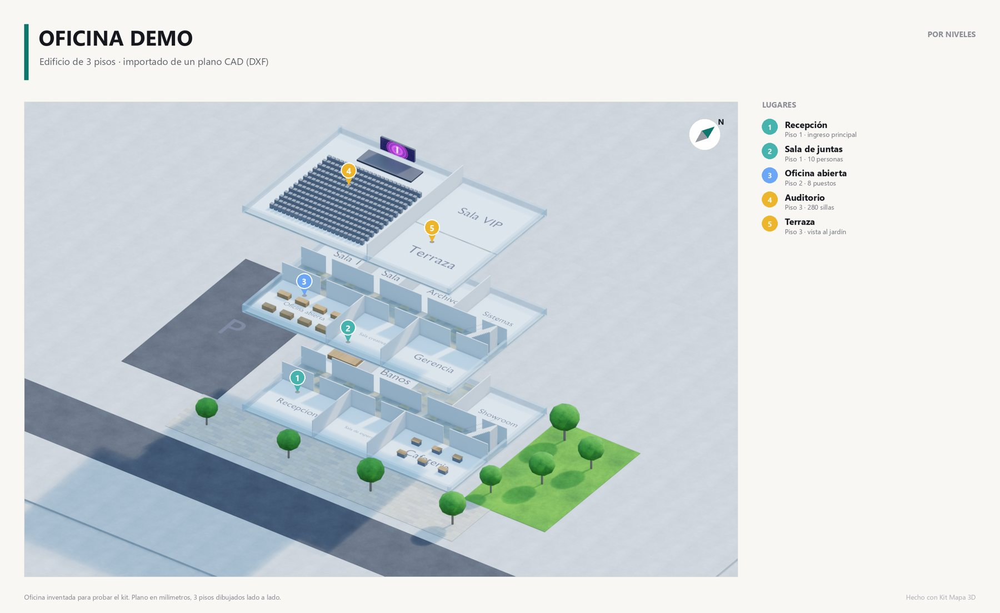
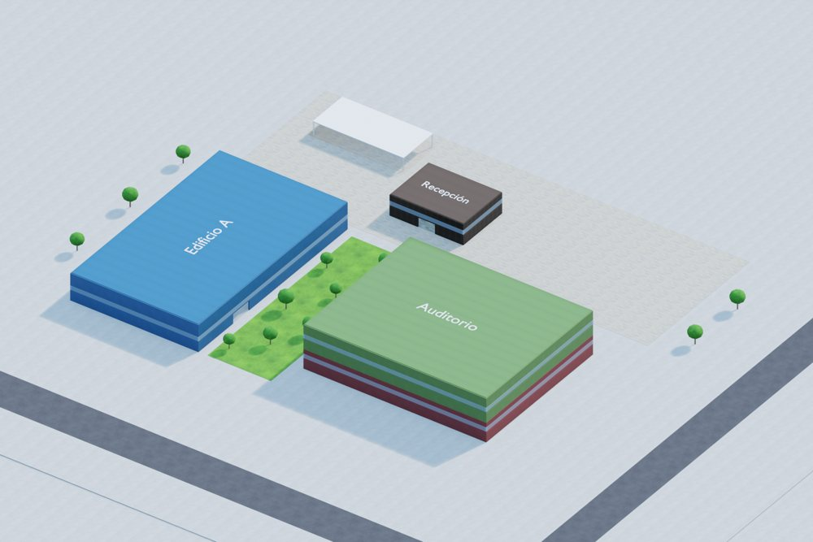
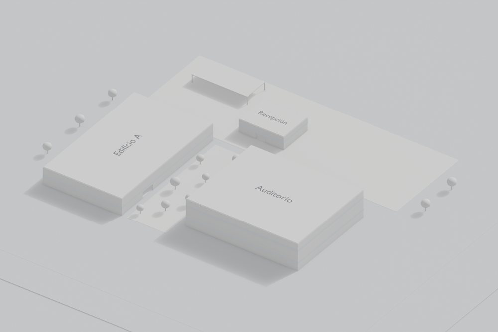
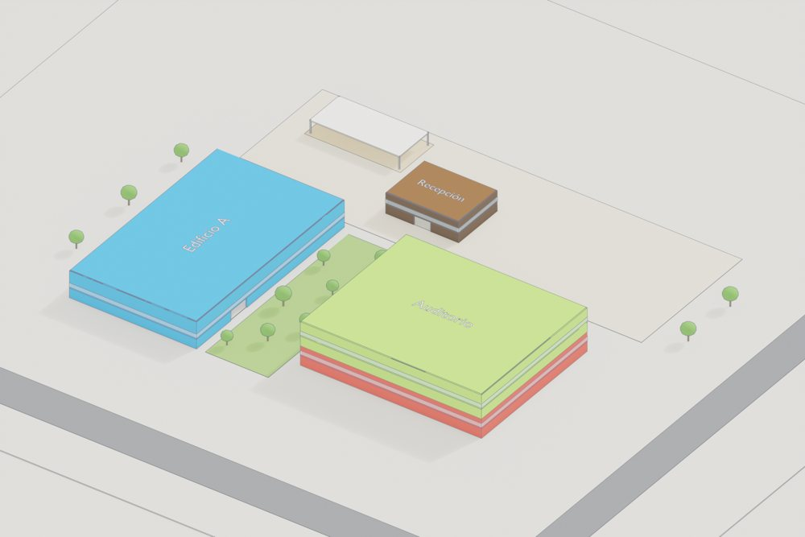
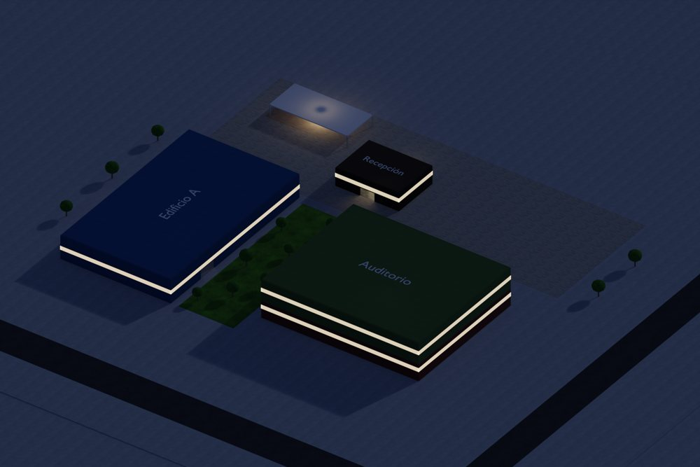
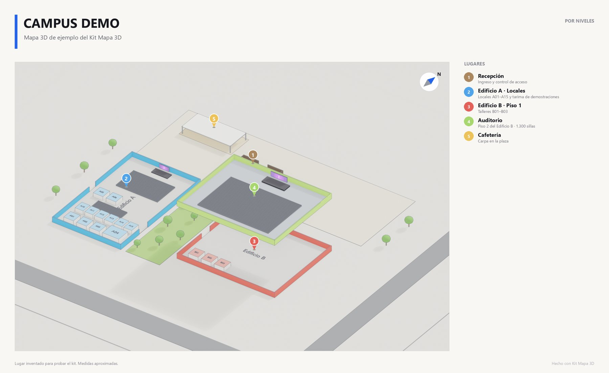

# Kit Mapa 3D

**Convierte cualquier plano en 3D con calidad profesional.** Sirve para un PDF, un CAD (DWG/DXF) o una simple imagen
de una oficina, una casa, un edificio, un campus, un centro comercial, un hotel o un recinto de eventos. Entrega:

- **Renders y láminas** en 4 estilos (realista, maqueta blanca, ilustrado, noche), hasta 8K o A1 a 300 ppp, con
  título, lugares numerados, leyenda, norte y escala.
- **Mapa web 3D navegable**, con tu marca. Se usa en el celular y en el computador, con:
  - modo **Por niveles**, en el que los pisos de arriba flotan para dejar ver los de abajo;
  - buscador de salas, locales u oficinas;
  - brújula;
  - links directos para poner en códigos QR.
- **Video de recorrido** en MP4.

Lo opera **Claude Code** guiado por los skills de este repo: te entrevista, te pide el plano, construye, te muestra
avances, pasa un control de calidad y entrega.



| Realista | Maqueta blanca |
|---|---|
|  |  |
| **Ilustrado** | **Noche** |
|  |  |



## Empezar

Abre **[PROMPT-DE-ENTREGA.md](PROMPT-DE-ENTREGA.md)**, copia el prompt y pégalo en Claude Code. Eso es todo.

Requisitos: [Claude Code](https://claude.com/claude-code), Python 3.10+ y [Blender](https://www.blender.org) 4.2+ (probado en 5.2).

## Cómo funciona

```
 plano.pdf ─┐                                   ┌─▶ renders.py ──▶ PNG 4K/8K/A1 ──▶ componer_lamina.py ──▶ lámina PNG + PDF
 plano.dxf ─┼─▶ extraer_plano.py ─▶ plano_m.json │
 imagen   ──┘   calibrar_imagen.py               ├─▶ exportar_web.py ──▶ web/ (three.js + GLB Draco) ──▶ Vercel · Netlify · iframe · app
                         │                       │
 mapa.json (marca, pisos, edificios, lugares) ─▶ construir_modelo.py (Blender) ─▶ modelo.blend ─▶ renders.py --video ──▶ MP4
```

| Carpeta | Qué hay |
|---|---|
| `.claude/skills/` | 8 skills: `mapa-3d` (orquestador), `mapa-plano-a-metros`, `mapa-modelo-blender`, `mapa-render-profesional`, `mapa-visor-web`, `mapa-video-recorrido`, `mapa-integrar-app`, `mapa-control-calidad` |
| `CLAUDE.md` / `AGENTS.md` | Instrucciones para el agente (Claude Code, Codex u otro) |
| `pipeline/` | Scripts: texturas, lectura de PDF/DXF/imagen, validación, construcción en Blender, renders y video, láminas, exportación web |
| `visor/` | Plantilla del mapa web (three.js) |
| `docs/` | Entrevista, formatos de entrada, formato de `mapa.json`, problemas conocidos, caso de origen |
| `ejemplos/campus-demo/` | Exteriores con varios edificios, a partir de un plano PDF |
| `ejemplos/oficina-demo/` | Edificio de 3 pisos con salas, a partir de un plano CAD (DXF) |
| `ejemplos/caso-origen-plaza-mayor/` | Código original del primer mapa real (un centro de convenciones), como referencia |
| `proyectos/` | Aquí va cada lugar nuevo (`python pipeline/nuevo_proyecto.py <id>`) |

## A mano, sin agente

```bash
pip install -r requirements.txt
python pipeline/generar_texturas.py
python ejemplos/oficina-demo/entrada/generar_dxf_demo.py
python pipeline/extraer_plano.py extraer ejemplos/oficina-demo/plano.json
blender -b --factory-startup --python pipeline/construir_modelo.py -- ejemplos/oficina-demo/mapa.json
blender -b ejemplos/oficina-demo/salida/modelo.blend --python pipeline/renders.py -- ejemplos/oficina-demo/mapa.json --estilo=ilustrado --vistas=niveles --tam=hd
python pipeline/componer_lamina.py ejemplos/oficina-demo/salida/renders/niveles_ilustrado.png
blender -b ejemplos/oficina-demo/salida/modelo.blend --python pipeline/exportar_web.py -- ejemplos/oficina-demo/mapa.json
python -m http.server 8766 --directory ejemplos/oficina-demo/salida/web
```

## Licencia

[MIT](LICENSE): úsalo, cámbialo y compártelo, también en proyectos comerciales, manteniendo el aviso de copyright.
Los decodificadores Draco de `visor/draco/` son de Google (Apache 2.0) y three.js se carga desde su CDN (MIT).

---

Parte de **La Bóveda del Master**: recursos que regala [Alexander Cast](https://github.com/AlexanderKast).
