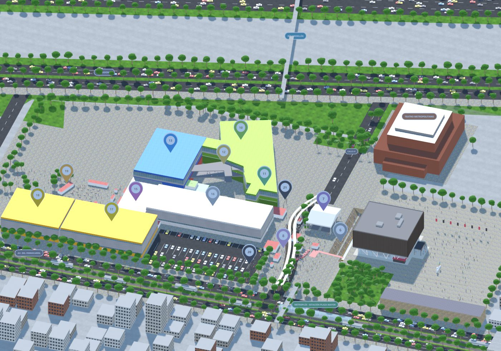
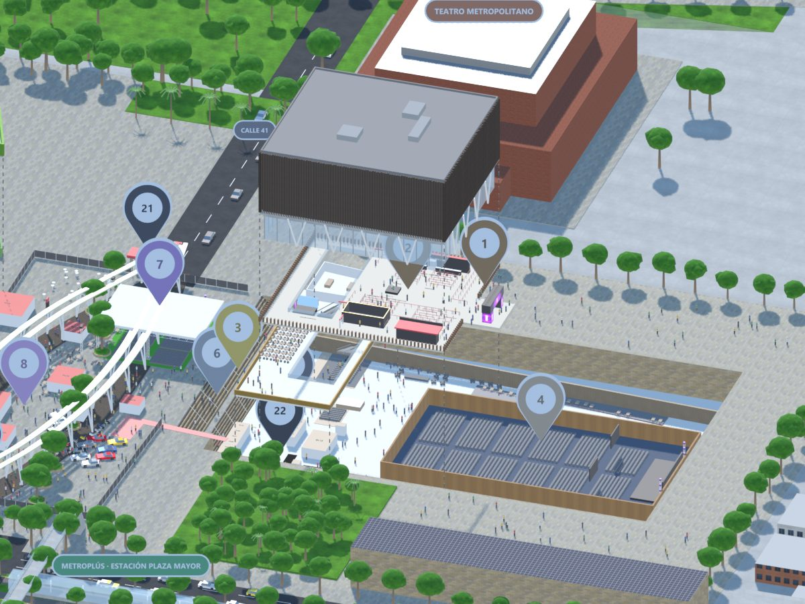

# Kit Mapa 3D de Recintos

Convierte el **plano en PDF de un recinto** en un **mapa 3D navegable en la web**. Sirve para centros de
convenciones, ferias, coliseos, campus o centros comerciales. El mapa trae:

- pabellones y salones a escala real;
- un modo **"Por niveles"**: los pisos de arriba flotan para dejar ver los de abajo;
- **pines numerados** de lugares, con lista y ficha;
- **stands buscables** por código o nombre;
- uso cómodo en el **celular** (hoja inferior, táctil, liviano);
- **renders** para presentar o imprimir y **video de recorrido**.

Lo arma **Claude Code** guiado por los skills de este repo: te entrevista, te pide el plano, construye, te muestra
avances y publica cuando le digas.




*Primer mapa hecho con este método: Plaza Mayor Medellín para Feria Effix 2026.*

## Empezar

Abre **[PROMPT-DE-ENTREGA.md](PROMPT-DE-ENTREGA.md)**, copia el prompt y pégalo en Claude Code. Eso es todo.

Requisitos: [Claude Code](https://claude.com/claude-code), Python 3.10+ y [Blender](https://www.blender.org) 4.2+ (probado en 5.2).

## Cómo funciona

```
plano.pdf ──extraer_plano.py──▶ plano_m.json (stands, sillas y zonas en metros)
                                      │
recinto.json (edificios, niveles, pines) ┘──construir_modelo.py (Blender)──▶ modelo.blend
                                                                                │
                                   ┌──────────exportar_web.py──────────────────┤
                                   ▼                                            ▼
              salida/web/  (index.html + mapa.glb con Draco + datos.json)   renders.py ─▶ PNG / MP4
                                   │
                    Vercel · Netlify · GitHub Pages · iframe · app React/Next
```

| Carpeta | Qué hay |
|---|---|
| `.claude/skills/` | 6 skills: `mapa-3d-recinto` (orquestador), `mapa-plano-a-metros`, `mapa-modelo-blender`, `mapa-visor-web`, `mapa-integrar-app`, `mapa-renders-video` |
| `CLAUDE.md` / `AGENTS.md` | Instrucciones para el agente (Claude Code, Codex u otro) |
| `pipeline/` | Scripts: texturas, extracción del PDF, validación, construcción en Blender, exportación web, renders y video |
| `visor/` | Visor web three.js (plantilla que el exportador copia a cada proyecto) |
| `docs/` | Entrevista, formato de `recinto.json`, problemas conocidos y el caso real de Plaza Mayor |
| `ejemplos/demo-centro-eventos/` | Recinto inventado, completo y probado de punta a punta, con plano PDF de juguete |
| `ejemplos/plaza-mayor/` | Fuente original del mapa de Plaza Mayor, integración en la app Next.js y renders |
| `proyectos/` | Aquí va cada recinto nuevo (`python pipeline/nuevo_proyecto.py <id>`) |

## A mano, sin agente

```bash
pip install -r requirements.txt
python pipeline/generar_texturas.py
python ejemplos/demo-centro-eventos/entrada/generar_plano_demo.py
python pipeline/extraer_plano.py extraer ejemplos/demo-centro-eventos/plano.json
blender -b --factory-startup --python pipeline/construir_modelo.py -- ejemplos/demo-centro-eventos/recinto.json
blender -b ejemplos/demo-centro-eventos/salida/modelo.blend --python pipeline/exportar_web.py -- ejemplos/demo-centro-eventos/recinto.json
python -m http.server 8765 --directory ejemplos/demo-centro-eventos/salida/web
```

Abre http://localhost:8765.

---

Parte de **La Bóveda del Master**: recursos que regala [Alexander Cast](https://github.com/AlexanderKast).
